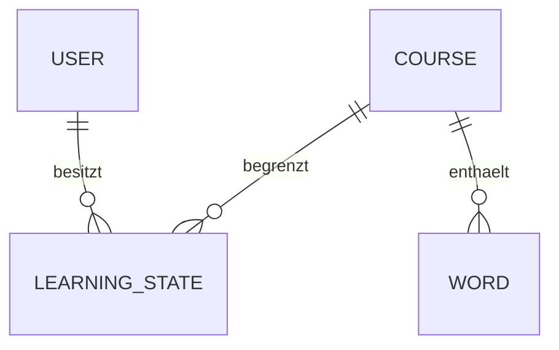
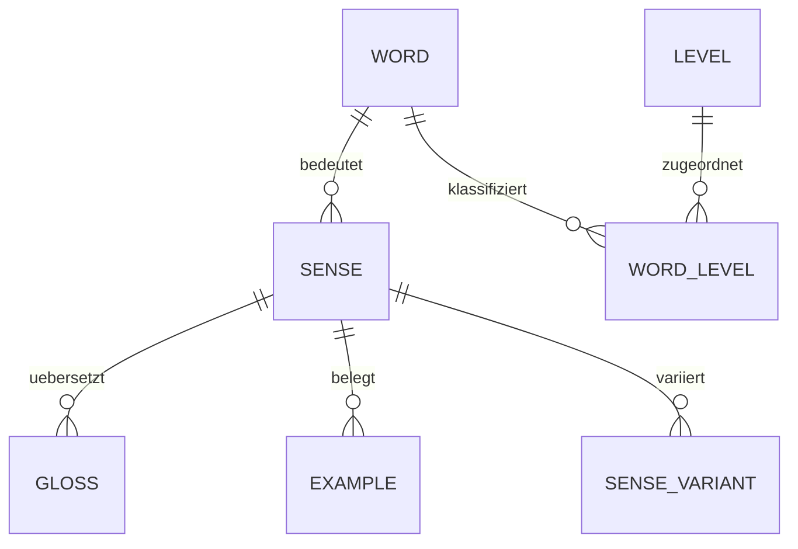
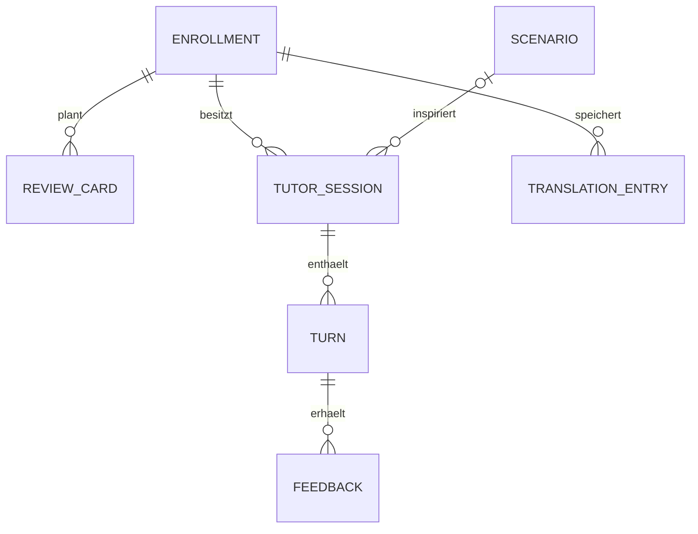

# LinguaFlow · Architektur und Datenmodell

Dieses Handbuch hält die bestehenden, verbindlichen Entscheidungen fest. Die mehrsprachige Zielarchitektur und der priorisierte Maßnahmenplan stehen in [ARCHITECTURE.md](ARCHITECTURE.md), ergänzt durch [LANGUAGE_CAPABILITIES.md](LANGUAGE_CAPABILITIES.md), [KNOWLEDGE_TREE.md](KNOWLEDGE_TREE.md) und [AI_INTEGRATION.md](AI_INTEGRATION.md).

## Entscheidung

Eine React-Anwendung, ein Django-Prozess und eine PostgreSQL-Datenbank bedienen alle Lernsprachen. nginx liefert das gebaute Frontend aus und leitet die API derselben Origin an Gunicorn weiter. Das Paket für GitHub Pages verwendet dieselbe Lernoberfläche im Gastmodus. React/Vite, TypeScript und Compose sind bereits in den Build-, Styling- und Veröffentlichungsablauf integriert. DRF ergänzt die öffentliche Katalog-API um typisierte Abfrageparameter. Die vorhandenen Sitzungs- und Synchronisierungsendpunkte behalten ihre Django-Implementierung und ihre v1-Verträge.

Der wichtigste Kompromiss ist der vollständige Lernstand pro Konto und Sprache. Er ermöglicht den Import älterer Sicherungen und atomare Schreibvorgänge mit Versionsprüfung. Dafür wird bei einer Änderung der ganze Stand übertragen, und zwei Geräte können unabhängig geänderte Karten noch nicht zusammenführen. Erst wenn gemessene Dokumentgrößen, häufige Konflikte oder eine serverseitige Fälligkeitsliste das rechtfertigen, werden Karten und Tagesaktivitäten relational. Die Spracherkennung im Browser, die Sprachmodell-Anbindung und die Aussprachebewertung sind drei verschiedene Aufgaben.

Das Web-Manifest und das responsive Layout bilden die mobile Basis. Der Gastmodus kann nach dem Laden lokal arbeiten. Ein Kaltstart ohne Netzwerk braucht zusätzlich einen getesteten Service Worker für App-Shell, Schriften und versionierte Sprachpakete. Private API-Antworten gehören nicht in diesen Cache. Capacitor kommt erst bei einem konkreten Bedarf an nativen Funktionen hinzu.

## Projektstruktur und Zuständigkeiten

| Pfad ab Projektwurzel                | Verantwortung                                                                    |
| ------------------------------------ | -------------------------------------------------------------------------------- |
| `src/main.tsx`                       | React-Einstieg, globale Styles und Sitzungsaufbau                                |
| `src/app/`                           | App-Komposition, Routen, gemeinsame Navigation und registrierte UI-Erweiterungen |
| `src/app/layouts/LearningLayout.tsx` | Gemeinsamer Sticky Header, Seitenleiste, Sprachwechsel und mobile Navigation     |
| `src/features/`                      | Sprachübergreifende Funktionen, jeweils ein Ordner pro Lernbereich               |
| `src/shared/ui/`                     | Dialoge, Bedienelemente und Sprachwechsel                                        |
| `src/shared/learning/`               | Wiederverwendete Lernkarten, Wortdetails und Rückmeldungen                       |
| `src/shared/lib/`                    | Tagesplan, Übungserzeugung, Wortgruppen und allgemeine Hilfen                    |
| `src/shared/audio/`                  | Sprachsynthese und Spracherkennung                                               |
| `src/state/learningStore.tsx`        | Persönlicher Lernzustand und Verbindung zur Synchronisierung                     |
| `src/languages/registry.ts`          | Datenregistrierung aller verfügbaren Sprachpakete                                |
| `src/languages/types.ts`             | Sprachübergreifende Inhaltsverträge                                              |
| `src/languages/zh/config.ts`         | Mandarin-Metadaten und verfügbare Spezialfunktionen                              |
| `src/languages/zh/content/`          | Wortschatz, Erklärungen, Dialoge, Lesetexte und Hörinhalte                       |
| `src/languages/zh/linguistics/`      | Pinyin-Verarbeitung                                                              |
| `src/languages/zh/exercises/tones/`  | Mandarin-Tonlabor                                                                |
| `src/languages/zh/presentation/`     | Mandarin-Startseite, Bilderzuordnung, Schrift und Kulturkalender                 |
| `src/styles/styles.css`              | Einziger CSS-Einstieg und globale Anpassungen                                    |
| `src/styles/`                        | Gemeinsame CSS-Bausteine, ausschließlich über styles.css geladen                 |
| `public/mandarin/`                   | Mandarin-Bilder; öffentliche URLs bleiben kompatibel                             |
| `scripts/`                           | Export, Initialisierung, Backups und Architektur-/Regressionstests               |
| `backend/accounts/`                  | Konten und Authentifizierung                                                     |
| `backend/catalog/`                   | Globale Kurse und Wortinhalte, Import und Katalog-API                            |
| `backend/learning/`                  | Private Lernstände und Synchronisierung                                          |
| `backend/*/migrations/`              | Bestehende Datenbankmigrationen                                                  |

### Abhängigkeiten und Erweiterungen

Die Datenregistrierung importiert ausschließlich serialisierbare Inhalte und reine
Sprachhilfen; sie importiert keine React-Komponenten. Damit kann derselbe Export
weiterhin im Django-Docker-Build verwendet werden. UI-Erweiterungen werden separat
in `app/languageViews.ts` eingebunden. Neue Sprachen verwenden standardmäßig das
gemeinsame Layout und den Tagesplan; eine eigene Startseite ist optional.

Gemeinsame Features dürfen keine Mandarin-Inhaltsdateien direkt importieren.
Sie beziehen Sprache und Inhalte über den Store beziehungsweise die Registrierung.
Das Mandarin-Tonlabor bleibt ein explizites Spezialmodul (`toneModule: "mandarin"`).
Eine Tonsprache bekommt dieses Modul nicht allein dadurch, dass sie Töne besitzt.

Navigation und direkte Routen verwenden beide `isModuleAvailable`. Fehlende
Dialog-, Hör- oder Leseinhalte blenden den jeweiligen Menüeintrag aus und leiten
direkte Aufrufe zur Startseite um. Die mobile Leiste hat maximal fünf Einträge.
Wort-IDs, API-v1-Endpunkte, Sprachcodes und lokale Speicherschlüssel bleiben stabil.
Die alte Teehaus-URL und `/practice` behalten ihre Weiterleitungen.

React-Komponenten verwenden PascalCase, Hilfsdateien camelCase, Python snake_case.
`npm run format` formatiert Frontend, Skripte und Dokumentation mit Prettier;
`npm run format:check` prüft dies ohne Änderungen. Die Datenbank bleibt ein modularer
Monolith mit einer gemeinsamen PostgreSQL-Datenbank. Diese Ordnerumstellung
benötigt keine Schema-Migration.

### Globale Styles

`src/main.tsx` importiert genau einmal `src/styles/styles.css`. Die Datei lädt
Basis-, Landingpage-, Formular- und Layoutregeln in fester Reihenfolge und danach
die Sprachthemen. Globale Anpassungen werden am Ende von `styles.css` ergänzt.
Dort stehen auch `--control-radius`, `--touch-target` und `--focus-color`.
Sprachthemen definieren ausschließlich ihre Bilder und Schriftarten; sie kopieren
keine Navigation, Formulare oder Lernlogik. Die vorhandene Mandarin-Gestaltung
bleibt durch dieselben Bild-URLs und CSS-Regeln erhalten. Layoutklassen mit dem
Präfix `mh-` bleiben aus Kompatibilitätsgründen bestehen und werden gemeinsam genutzt.

## Datenbank im MVP



| Physische Tabelle                                                    | Schlüssel, Beziehungen und Regeln                                                                                                                         |
| -------------------------------------------------------------------- | --------------------------------------------------------------------------------------------------------------------------------------------------------- |
| auth_user, auth_group, auth_permission und Django-Zuordnungstabellen | Django-Primärschlüssel, eindeutiger Benutzername, Passwort-Hash und Gruppenrechte                                                                         |
| django_session                                                       | Sitzungsschlüssel als PK, Ablaufzeit indexiert; Cookie enthält den Sitzungsschlüssel                                                                      |
| learning_course                                                      | code als PK, name und content JSONB für das ausgelieferte Paket                                                                                           |
| learning_word                                                        | id als PK, course_id als FK, UNIQUE(course_id,key), Index über (course_id,category,level), position bestimmt die Reihenfolge, active steuert Sichtbarkeit |
| learning_learningstate                                               | id als PK, user_id als FK mit Kaskade, language als FK auf Kurscode mit Löschschutz, UNIQUE(user_id,language), revision, updated_at, document JSONB       |

Ein Wort kann im aktuellen Austauschformat eine deutsche Glosse, ein Beispiel und eine Hauptkategorie tragen. Die Lernstand-Revision ist pro Konto **und** Kurs. Anwendungsvalidierung kontrolliert Box, Fälligkeit, Zähler, Einstellungen und eigene Wörter. Der Client berechnet XP für die persönliche Lernhilfe. Ein Wettbewerbsranking bräuchte eine serverseitige Bewertung. Private Fundstücke liegen im Lernstand und erscheinen nie im öffentlichen Wörter-Endpunkt.

## Relationales Zielmodell nach Bedarf

Die folgenden Tabellen sind der Ausbauentwurf. Die Namen bezeichnen logische Tabellen, bis eine App-Migration sie tatsächlich einführt. Jede Tabelle erhält einen bigint-PK, sofern unten ein anderer Schlüssel genannt ist. Alle genannten Verweise sind Fremdschlüssel. Zuordnungstabellen haben einen zusammengesetzten UNIQUE-Schlüssel bzw. PK. Für die konkrete PostgreSQL-Migration gelten zusätzlich die unten genannten sprachübergreifenden Integritätsregeln.

| Bereich                       | Tabellen und Integrität                                                                                                                                                                                                                                                                                                                                                                                        |
| ----------------------------- | -------------------------------------------------------------------------------------------------------------------------------------------------------------------------------------------------------------------------------------------------------------------------------------------------------------------------------------------------------------------------------------------------------------- |
| Pakete und Herkunft           | package_release(course_id, version, digest, imported_at), UNIQUE(course_id,version). source(id, title, locator, license). content_revision(release_id, source_id, quality_status, reviewed_by, reviewed_at), mit Status draft, generated, reviewed, retired. Wortbedeutungen, Beispiele und Lektionen referenzieren ihre Revision. Prüfer ist optional und wird bei Kontolöschung auf NULL gesetzt.            |
| Bedeutungen und Übersetzungen | word_sense(word_id, stable_key, register, revision_id), UNIQUE(word_id,stable_key). gloss(sense_id, locale, text), UNIQUE(sense_id,locale,text). example(sense_id, text, reading, revision_id) und example_translation(example_id, locale, text). Register liegt an der Bedeutung und erlaubt neutral, formal, informal, unspecified.                                                                          |
| Sprachvarianten               | variety(course_id, tag, label), UNIQUE(course_id,tag). sense_variant(sense_id,variety_id,surface,reading), UNIQUE(sense_id,variety_id,surface). Ein Mandarin-Eintrag kann etwa Formen aus zh-CN und zh-TW verbinden.                                                                                                                                                                                           |
| Kategorien und Stufen         | category(course_id,slug,label), UNIQUE(course_id,slug). word_category(word_id,category_id). level_system(code,edition), UNIQUE(code,edition). level(system_id,code,rank), UNIQUE(system_id,code). course_level(course_id,level_id). word_level(word_id,level_id,source_id). Ohne Zuordnung bleibt ein Wort normal trainierbar. CEFR-Einschätzungen separat von belegten HSK- oder JLPT-Listeneinträgen führen. |
| Grammatik und Übungen         | grammar_lesson(course_id,slug,title,revision_id), UNIQUE(course_id,slug). exercise(lesson_id,position,kind,prompt,answer_spec), UNIQUE(lesson_id,position). Antwortschema pro kind validieren. Übungsversuche gehören zum Lernkonto.                                                                                                                                                                           |
| Szenarien                     | scenario(course_id,slug,title,revision_id), UNIQUE(course_id,slug). scenario_line(scenario_id,position,role,text,reading), UNIQUE(scenario_id,position). Kuratierte Beispieldialoge bleiben für alle Lernenden gleich.                                                                                                                                                                                         |
| Persönliche Karten            | Der bestehende LearningState bildet die Einschreibung. personal_word(enrollment_id,key,surface,reading), UNIQUE(enrollment_id,key). review_card(enrollment_id,word_id NULL,personal_word_id NULL,box,due_on,right_count,wrong_count). CHECK genau ein Wortbezug, nichtnegative Zähler, Box 0–6. Zwei partielle UNIQUE-Indizes je Einschreibung und Wortbezug, Index (enrollment_id,due_on).                    |
| Fortschritt                   | daily_activity(enrollment_id,local_date,xp,lesson_count,review_count,apply_count), UNIQUE(enrollment_id,local_date). exercise_attempt(enrollment_id,exercise_id,client_event_id,result,occurred_at), UNIQUE(enrollment_id,client_event_id) für idempotente Wiederholungen.                                                                                                                                     |
| Gespräche und KI-Feedback     | tutor_session(enrollment_id,scenario_id NULL,provider,model,created_at,expires_at). turn(session_id,position,role,text), UNIQUE(session_id,position). feedback(turn_id,kind,original_span,suggestion,explanation). Ein Szenario ist optional, der Eigentümer ergibt sich aus der Einschreibung.                                                                                                                |
| Übersetzungen                 | translation_entry(enrollment_id,source_locale,target_locale,input,output,provider,created_at,expires_at). Index (enrollment_id,created_at). Nur bei aktiviertem Verlauf persistieren.                                                                                                                                                                                                                          |
| Aufnahmen                     | Bei einem Bedarf an gespeichertem Audio recording(turn_id,object_key,expires_at,deleted_at) mit Index auf expires_at. Audio selbst liegt in privatem Objektspeicher.                                                                                                                                                                                                                                           |

**Sprachgrenzen in PostgreSQL.** Wo zwei FKs dieselbe Sprache haben müssen, auf beiden Eltern UNIQUE(id,course_id) und auf der Zuordnung zusammengesetzte FKs (word_id,course_id) und (category_id,course_id) setzen. Entsprechend für Einschreibung/Katalogwort, Szenario/Einschreibung und Übung/Versuch. Für Privatwörter mit UNIQUE(id,enrollment_id) Eigentum bis zur Karte erzwingen. Diese Regeln gehören in dieselbe Migration wie die neuen Tabellen. Die Anwendung beschränkt zusätzlich jede private Abfrage auf request.user. Katalogeinträge mit Lernhistorie werden deaktiviert. Ein gelöschtes Lernkonto kaskadiert nur in private Tabellen.





## Lern-Engine und Sprachpakete

Ein neues Paket implementiert Language mit Code, Lerninhalten, TTS-Locale, Lesungsbezeichnung, Kulturdarstellung und optionaler Normalisierung der Lesung. tonePractice aktiviert das Mandarin-Tonlabor in Navigation und Tagesplan. Andere Sprachen erhalten den gemeinsamen Lernablauf. Für eine weitere Tonsprache mit anderer Tonzahl ist ein eigener Übungstyp bzw. eine konfigurierbare Toninventarliste nötig. Die heutigen deutschen Glossen und die CEFR-Auswahl sind bewusst Teil des MVP.

Beispiel eines Mandarin-Paketausschnitts für den Import-Test:

```json
[
  {
    "code": "zh",
    "name": "Mandarin",
    "categories": [{ "id": "food" }],
    "vocab": [
      {
        "id": "zh:茶:chá:n",
        "target": "茶",
        "reading": "chá",
        "de": "Tee",
        "category": "food",
        "pos": "noun",
        "level": "A1"
      },
      {
        "id": "zh:水:shuǐ:n",
        "target": "水",
        "reading": "shuǐ",
        "de": "Wasser",
        "category": "food",
        "pos": "noun",
        "level": "A1"
      }
    ]
  }
]
```

Im Zielmodell könnte eine Bedeutung von 您 (nín) das Register formal und die deutsche Glosse „Sie“ erhalten. Dieselbe Bedeutung darf den Kategorien „Anrede“ und „Höflichkeit“ angehören. Eine Prüfungsstufe wird erst mit Quelle und Listenausgabe eingetragen.

Die Autoren pflegen Paketquellen im Repository. Der Build exportiert sie über dieselbe Registry wie der Browser. Der Django-Import läuft in einer Transaktion, aktualisiert anhand (course,key), erhält Wort-PKs und deaktiviert entfernte Wörter. Ein doppelter Schlüssel im exportierten Paket oder eine unbekannte Kategorie bricht die Transaktion ab. Der historische TS-Parser dedupliziert Rohzeilen bereits vorher. Für Fremdpakete vor Freigabe Rohdaten, Lizenz, ID-Kollisionen und Sprachqualität gesondert prüfen. Neue Schlüssel sollten als unveränderliche IDs vergeben werden. Bei alten, aus Schrift und Lesung gebildeten IDs erfordert eine Korrektur einen expliziten Alias samt Lernstandmigration.

## API v1

| Ressource                                 | Zugriff und Vertrag                                                                                                                     |
| ----------------------------------------- | --------------------------------------------------------------------------------------------------------------------------------------- |
| GET /api/v1/courses/ und /courses/{code}/ | Öffentlich. Paketübersicht bzw. Sprachkonfiguration einschließlich Lesetexten und Dialogen                                              |
| GET /api/v1/courses/{code}/words/         | Öffentlich. q durchsucht Schrift, Lesung und deutsche Bedeutung. category und level filtern exakt. offset ≥ 0, limit 1–200, Standard 50 |
| GET /api/v1/session/                      | Aktuelle Sitzung und CSRF-Token                                                                                                         |
| POST /api/v1/register/, /login/, /logout/ | Anmeldung/Registrierung mit username und password, CSRF für alle drei Endpunkte                                                         |
| GET, PUT /api/v1/state/{code}/            | Eigentümer aus der Sitzung. X-Learner schützt vor versehentlichem Schreiben nach Kontowechsel. PUT enthält revision und document        |
| GET, DELETE /api/v1/me/                   | Export aller Sprachstände bzw. Kontolöschung nach Passwortbestätigung per JSON. Beides erfordert eine Sitzung, DELETE zusätzlich CSRF   |
| GET /api/v1/health/                       | Prüft die Datenbankverbindung                                                                                                           |

Beispiel: GET /api/v1/courses/zh/words/?q=chá&limit=1 liefert {"count":N,"results":[…]}. Ein neuer Lernstand liefert {"revision":0,"document":null}. Beim Speichern folgt {"revision":1}. HTTP 400 kennzeichnet ungültige Daten, 401 eine fehlende Sitzung bei privaten Ressourcen, 403 abgewiesenes CSRF/Passwort, 404 einen unbekannten Kurs, 409 eine veraltete Revision oder einen Kontowechsel und 429 zu viele Anmeldeversuche. DRF liefert Validierungsfehler nach Feld und 404 mit detail; die bisherigen JSON-Views verwenden error, die Django-CSRF-Middleware kann HTML zurückgeben. Clients behandeln zuerst den Status. Additive Felder sind mit v1 vereinbar, eine Umdeutung bestehender Felder benötigt v2 und eine dokumentierte Übergangsfrist.

Spätere APIs folgen dem Fachablauf: GET /courses/{code}/grammar/, POST /state/{code}/attempts/, POST /courses/{code}/tutor/sessions/, POST /tutor/sessions/{id}/turns/ und POST /courses/{code}/translations/. Ein TutorService lädt die eigene Sitzung, minimiert Kontext und ruft einen serverseitig ausgewählten Provider über eine kleine Schnittstelle generate(messages, language, timeout) auf. Der Adapter liefert Text, Modellkennung und optional strukturiertes Feedback zurück. Schema und Größenlimits prüfen, Timeouts behandeln; ein fehlgeschlagener Aufruf erzeugt keine fertige Antwort. Lokales Ollama und eine externe API implementieren dieselbe Schnittstelle. Keine automatische Weitergabe an externe Anbieter bei Ausfall des lokalen Modells. Zugangsdaten werden nur im gewählten Prozess injiziert.

## Datenschutz und Betrieb

- Im MVP dient der Browser per Sitzungs-Cookie und CSRF als einziger schreibender Client. Lernende dürfen eigene Daten lesen und ändern. Kursinhalte sind über HTTP schreibgeschützt. Der Import ist ein Betreiberkommando. Künftige Redaktion erhält Django-Gruppen mit einzelnen Katalogrechten. Zugriff auf private Gespräche ist eine eigene Berechtigung.
- Der Standardbetrieb bindet nginx an Loopback. Für LAN oder Internet vor Freigabe TLS an einem vertrauenswürdigen Reverse Proxy terminieren, Host-Allowlist setzen, Secure-Cookies per DJANGO_HTTPS=1 aktivieren und die HTTPS-Origin für CSRF exakt konfigurieren. Forwarded-Header nur vom eigenen Proxy akzeptieren. Keine Datenbankports veröffentlichen. Keine Passwörter, Sprachtexte oder Prompts in Anfragelogs.
- Django hasht Passwörter. Lokale Secrets liegen in der ignorierten .env mit restriktiven Dateirechten. Externe KI bleibt ausgeschaltet, bis der Benutzer Anbieter, gesendete Daten und Speicherverhalten gewählt hat. Browser-Spracherkennung kann vom Browseranbieter verarbeitet werden; selbst gehostete Django-Endpunkte speichern derzeit keine Audiodateien.
- Für die erste eigene Sprachaufnahme als Standard Verarbeitung im Arbeitsspeicher wählen. Falls ein Job eine Datei braucht, nach Verarbeitung entfernen und höchstens 24 Stunden als festgelegtes Produktlimit zulassen. Löschjob und Monitoring vor Aktivierung testen. Gesprächs- und Übersetzungsverlauf per Opt-in mit konfigurierbarer Frist. Export und Kaskadenlöschung um jede private Tabelle erweitern. Backups altern nach ihrer eigenen Frist aus.
- Der vorhandene UI-Export gilt für eine Sprache. GET /me/ exportiert alle Serverstände. DELETE /me/ entfernt das Konto. Gastdaten, heruntergeladene Exporte und lokale Tab-Entwürfe sind eigene Kopien.
- Vor Migrationen und regelmäßig mit pg_dump sichern. Archive verschlüsselt außerhalb des Docker-Volumes halten und mit Datum, App-Version und Schema-Version versehen. Beispiel für einen Wiederherstellungstest in einer separaten, leeren Datenbank im lokalen Compose-Stack:

```bash
mkdir -p backups
(umask 077 && docker compose exec -T db sh -ec 'exec pg_dump -Fc -U "$POSTGRES_USER" "$POSTGRES_DB"' > backups/restore-test.dump)
docker compose exec -T db sh -ec 'createdb -U "$POSTGRES_USER" linguaflow_restore_test'
docker compose exec -T db sh -ec 'pg_restore -U "$POSTGRES_USER" --exit-on-error --no-owner -d linguaflow_restore_test' < backups/restore-test.dump
docker compose exec -T db sh -ec 'psql -U "$POSTGRES_USER" -d linguaflow_restore_test -c "SELECT count(*) FROM learning_word"'
```

Prüfe zusätzlich Benutzerzahl, Lernstandrevisionen und eine stichprobenartige Anmeldung an einer isolierten Wiederherstellungsinstanz. Die Frist für Backup-Aufbewahrung muss zur gewählten Löschfrist passen.

## Migrations- und Implementierungsreihenfolge

1. **MVP-Grundlage, umgesetzt.** Bestehende URLs und Tabellen beibehalten, Katalog über migrations.SeparateDatabaseAndState der neuen App zuordnen. Aktive Wörter kennzeichnen. Bereits gespeicherte Sprachcodes vor Anlegen des FK durch Kurszeilen abdecken. So bleiben Benutzer, Wort-PKs und Lernstandrevisionen erhalten.
2. **Vor der zweiten Sprache.** Zweites vollständiges Testpaket durch Build, Katalog und Lern-UI führen. Offline-Kaltstart, Sprachwechsel mit ausstehendem Entwurf und Gerätekonflikte im Browser testen. Der API-Integrationstest prüft bereits zwei getrennte Sprachstände. Für serverübergreifende automatische Konfliktauflösung wären einzelne Lernereignisse nötig.
3. **Vor redaktioneller Pflege.** Releases und Provenienz einführen, danach Bedeutungen, Glossen und Mehrfachzuordnungen. Bestehende JSON-Nutzdaten zunächst mit stabilen IDs zurückfüllen. Alte und neue Repräsentation anhand von Anzahl, Schlüsseln und Beispielen vergleichen. v1-Ausgabe aus den neuen Daten erzeugen. Erst nach erfolgreicher Übergangsphase redundante Spalten entfernen.
4. **Wenn serverseitige Wiederholung nötig wird.** Kartentabellen additiv anlegen, Lernstände nach Konto und Sprache in kleinen, wiederholbaren Batches migrieren, Unbekanntes zur Klärung protokollieren. Während des Übergangs pro Transaktion konsistent schreiben oder ein Wartungsfenster nutzen. Umschalten nach vollständigem Abgleich. Ein Rollback nach neuen Schreibvorgängen benötigt Rückmigration oder Wiederherstellung samt Nachführung.
5. **Neue Lernmodule.** Eine Grammatiklektion samt auswertbarer Übung und einen Dialog zuerst vertikal liefern. Dann lokalen KI-Adapter anbinden und mit einem deterministischen Testadapter prüfen. Externen Anbieter und freiwilligen Verlauf erst nach Löschen, Export, Timeout- und Datenschutztests aktivieren.

Für jede Schemaänderung Migration ins Repository legen, gegen ein leeres Schema und gegen eine Kopie des vorherigen Releases prüfen. CI baut beide Images, startet PostgreSQL, führt Django-Tests aus und prüft die Wort-API über nginx. Vor einem produktiven Rollout zusätzlich Backup-Wiederherstellung und Browser-Lernablauf verifizieren.

## Abgleich mit dem Architekturplan

| Geplant                                    | Umgesetzt                                                                                                |
| ------------------------------------------ | -------------------------------------------------------------------------------------------------------- |
| Mandarin in einem erkennbaren Sprachordner | `src/languages/zh/` mit Konfiguration, Inhalten, Pinyin, Tonlabor und Darstellung                        |
| Gemeinsame Lernfunktionen                  | Featureordner für Vokabeln, Lektionen, Wiederholen, Dialoge, Sprechen, Hören, Lesen, Quiz und Fundstücke |
| Einheitliche Navigation                    | `app/navigation.ts`; dieselbe Verfügbarkeitsprüfung für Menüs und Routen                                 |
| Gemeinsamer Header und mobile Navigation   | `LearningLayout`; Mandarin nutzt weiterhin seine kulturelle Gestaltung                                   |
| Globale Styles                             | `styles/styles.css` als einziger CSS-Einstieg mit gemeinsamen Variablen und Regeln                       |
| Erweiterbare Sprachoberflächen             | Reine Datenregistrierung getrennt von `app/languageViews.ts`                                             |
| Erhalt bestehender Daten                   | Alle 4.691 Wort-IDs samt Reihenfolge gegen den bisherigen Git-Katalog abgeglichen                        |
| Einheitliche Formatierung                  | Prettier-Konfiguration und Formatierungsbefehle                                                          |

Bewusste Vereinfachungen: Es gibt keinen leeren `providers/`-Ordner; der bestehende
Kontoeinstieg und der Lernstore bleiben an ihren fachlichen Orten. Globale
Designvariablen stehen direkt in `styles.css` beziehungsweise dessen Basisdatei;
eine zusätzliche `tokens.css` ist dafür derzeit nicht nötig. Öffentliche Bilder
bleiben unter `public/mandarin/`, damit vorhandene URLs stabil bleiben.

Geprüft wurden der Produktionsbuild, Formatierung, Architektur- und Lernplantests,
14 Django-Tests auf einer isolierten SQLite-Datenbank sowie Export und Import des
gesamten Katalogs. Im Browser wurden Mandarin-Startseite, Wortdetails mit Erklärung,
Dialogliste und die mobile Navigation mit fünf Bereichen geprüft. Ein echter
Sprachwechsel auf einen zweiten vollständigen Kurs bleibt zu prüfen, sobald ein
solcher Kurs existiert. Der laufende Docker-Stack wurde bei dieser Umstrukturierung
nicht neu gebaut. Der Build meldet weiterhin einen großen Inhalts-Chunk; späteres
Laden einzelner Sprachpakete ist eine separate Performance-Verbesserung.
